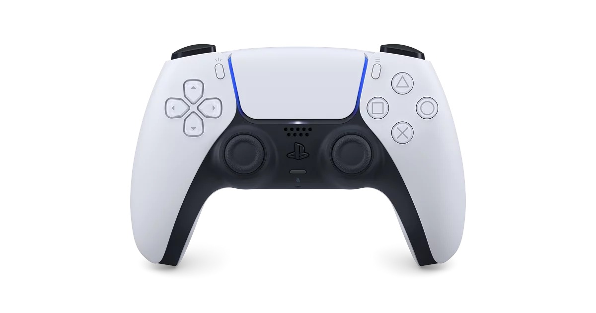

# DualSense Bluetooth Audio


Stream Windows audio to the DualSense built-in speaker or headset jack over
Bluetooth. The project uses WASAPI loopback capture, Opus encoding, and HID
reports sent through a dedicated queue.



## Features

- Complete WPF interface with no console window during normal use.
- Output through the DualSense speaker or a headset connected to its 3.5 mm jack.
- Windows audio output selection.
- Real-time volume control.
- Full39 protocol with ClockFix, Opus, and SendQueue.
- Integrated diagnostics and HID connection test.
- Experimental RGB lighting controller marked as **BETA**.
- Coexists with DSX for mapping and lighting.
- Self-contained Windows builds for x64 and x86.
- Real vector icons in XAML; emojis are not used as icons.

## Version 0.0.1 status

The audio path is the main feature and is functional. Lighting control is
experimental. While DSX is open, DSX keeps control of the lightbar and colors
selected in this application will not be applied.

## Requirements

To run a published build:

- Windows 10 or Windows 11;
- a DualSense connected over Bluetooth;
- a Bluetooth adapter with stable HID support.

To build the project:

- Windows 10 or Windows 11;
- .NET 9 SDK;
- NuGet access during the first restore.

## Build

Run `BUILD_APP.bat` from the repository root. It builds both architectures and
creates GitHub Release packages:

```text
release\DualSense-Bluetooth-Audio_v0.0.1_win-x64.zip
release\DualSense-Bluetooth-Audio_v0.0.1_win-x86.zip
```

To build only one architecture, run `BUILD_X64.bat` or `BUILD_X86.bat`.
Published builds are self-contained, so end users do not need to install the
.NET Runtime.

## Usage

1. Connect the DualSense to Windows over Bluetooth.
2. Connect a headset to the controller if you want to use the 3.5 mm output.
3. Open `DualSenseAudioStudio.exe`.
4. Select **Test connection**.
5. Select the Windows output that is currently playing audio.
6. Select **Headset jack** or **Controller speaker**.
7. Select **Start audio**.

## DSX and Lighting BETA

Lighting control from this application is disabled by default, allowing DSX to
remain responsible for the LEDs and controller mapping. To test this project's
RGB editor, close DSX completely before starting audio, then enable
**Control lighting with this app**.

If HidHide hides the physical controller, add `DualSenseAudioStudio.exe` and
`DualSenseBtAudio.exe` to the HidHide application list. Otherwise, the audio
engine may not find the DualSense.

## Repository structure

```text
src/DualSenseAudioStudio/   WPF interface and session management
src/DualSenseBtAudio/       Audio engine, Opus, and HID protocol
docs/                       Technical and publishing documentation
tools/protocol-lab/         Manual protocol laboratory tests
.github/                    Build automation and repository templates
```

## Known limitations

- Does not create a dedicated endpoint in Windows Sound Settings.
- Does not implement a Bluetooth microphone or virtual audio driver.
- Lighting support is still BETA.
- Stability may vary with controller firmware and Bluetooth adapters.
- This application is not a complete controller remapper.

## Contributing and security

Read [CONTRIBUTING.md](CONTRIBUTING.md) before submitting changes. Report
security issues according to [SECURITY.md](SECURITY.md).

Repository and first-release instructions are available in
[docs/PUBLISHING.md](docs/PUBLISHING.md).

## Credits and license

The core was developed from research and compatible code related to the
`dualsense-bt-haptics` project. Dependencies and attribution are listed in
[THIRD_PARTY_NOTICES.md](THIRD_PARTY_NOTICES.md).

Distributed under the [MIT License](LICENSE).

DualSense and PlayStation are trademarks of their respective owners. This is
an unofficial community project and is not affiliated with Sony Interactive
Entertainment.
